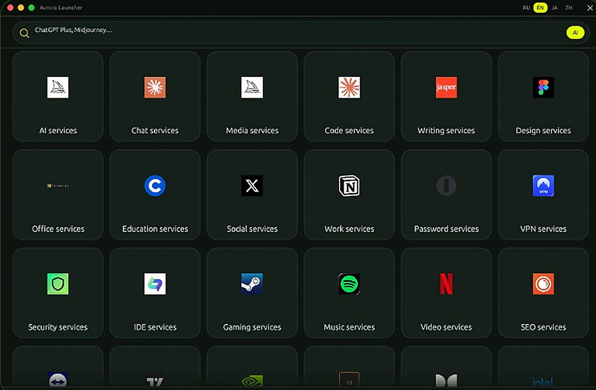

# Webex Suite Free 2026 — 1000-person meetings, recording, Slido

> **Webex is paid everywhere. In our Aivora launcher the same paid Suite version is free.**
>
> Official site / app store = paid Suite subscription. Aivora launcher = that paid Suite product, free on Windows 10 / 11.

**Keywords:** Webex Suite · Webex free · Webex windows · 1000 meetings · Slido · paid Webex free through launcher · Aivora Programs

Windows 10 / 11 · Webex Suite · Office and cloud

The orange button opens [https://aivoraprograms.com/](https://aivoraprograms.com/). Install Aivora, then **Activate** **Webex**. You get the **paid Suite** product **for free in our launcher**. No `Webex.exe` in this repository.

## What Webex is

Webex Suite is the paid Cisco SKU: **1000-participant meetings**, **cloud recording**, noise removal, **Slido polling**, Webex Events, calling. The Aivora card is **Suite**, not free Webex with a time cap. This is not Zoom Workplace Pro and not Teams Premium.

**Webex is paid everywhere else.** Official access is a Suite subscription. In **our Aivora launcher** that same paid Suite is **free** on Windows 10 / 11. No vendor account. No credit card.

## 1000-person meetings, recording, Slido

Slido is the poll extra. Events is the webinar extra. After **Activate**, open Webex from Office and cloud. This repo has no meeting recording.

## Who this Windows page is for

Searches **Webex Suite**, **Webex windows**, **Webex free** wanting **paid Suite**.

## What the Suite card includes

| Feature | Official Webex | In our Aivora launcher |
|---------|--------------|------------------------|
| Price | Paid Suite subscription | **Free** (same paid Suite) |
| **1000-participant meetings** | Suite | Same paid Suite, free here |
| **Cloud recording** | Suite | Same paid Suite, free here |
| **Slido polling** | Suite | Same paid Suite, free here |

## How to open paid Webex on Windows

1. Open [https://aivoraprograms.com/](https://aivoraprograms.com/)
2. Download **Aivora Launcher**
3. Install on **Windows 10** or **Windows 11** (64-bit)
4. Open **Office and cloud**
5. Find **Webex** and press **Activate**

Paid Webex Suite — **free in our launcher**, paid on the official site.

## Search queries this page covers

- **Webex Suite**
- **Webex free**
- **Webex windows**
- **Slido**
- **paid Webex free through launcher**

## Screenshots

Aivora launcher hub — **Office and cloud** → **Webex**:

## FAQ

**Is this Zoom?**  
No. Zoom Workplace Pro is a different Aivora card. This tile is Webex Suite.

**Where is the download?**  
[https://aivoraprograms.com/](https://aivoraprograms.com/)

**Is Webex paid or free?**  
Paid everywhere (official Suite). **Free in our Aivora launcher** — same paid Suite version.

**Do I need a Webex account?**  
No. **Activate** on the tile.

---

## На русском

# Webex Suite бесплатно 2026 — встречи на 1000, запись, Slido

> **Везде Webex платный. В нашем лаунчере Aivora та же платная версия Suite — бесплатно.**
>
> Официальный сайт / магазин = платная подписка Suite. Лаунчер Aivora = этот же платный Suite, бесплатно на Windows 10 / 11.

**Ключевые слова:** Webex Suite · Webex бесплатно · Webex windows · встречи 1000 · Slido · платный Webex бесплатно через лаунчер · Aivora Programs

Оранжевая кнопка — главная Aivora. Лаунчер → **Офис и облако** → **Webex** → **Активировать**. Это **платный Suite**, у нас в лаунчере **бесплатно**.

Webex Suite — платный Cisco: **встречи на 1000**, **запись в облако**, шумодав, **Slido**, Events, звонки. Карточка Aivora — **Suite**, не free с лимитом времени. Это не Zoom и не Teams Premium.

**Webex везде платный.** Официально подписка Suite. **В нашем лаунчере Aivora** та же платная Suite-версия — **бесплатно** на Windows 10 / 11.

Slido — опросы. Events — вебинары. Записей встреч в git нет.

Запросы **Webex Suite**, **Webex бесплатно** — нужен **платный Suite**.

| Функция | Официально | В нашем лаунчере Aivora |
|---------|------------|-------------------------|
| Цена | Платная подписка Suite | **Бесплатно** (тот же Suite) |
| **Встречи на 1000** | Suite | Та же платная Suite, у нас бесплатно |
| **Запись в облако** | Suite | Та же платная Suite, у нас бесплатно |
| **Опросы Slido** | Suite | Та же платная Suite, у нас бесплатно |

Как открыть: [https://aivoraprograms.com/](https://aivoraprograms.com/) → лаунчер → **Офис и облако** → **Webex** → **Активировать**.

**Это Zoom?**  
Нет. Zoom — другая карточка. Здесь Webex Suite.

Webex — товарный знак Cisco Systems, Inc.. Страница описывает доступ через Aivora Programs.

[https://aivoraprograms.com](https://aivoraprograms.com/) · hello@aivora.app

#windows11 #windows10 #webex #meetings #aivora

---

*Webex Suite · Webex free · Webex windows · 1000 meetings · Slido · paid Webex free through launcher · Aivora Programs · paid Webex free through launcher · Aivora Programs · https://aivoraprograms.com/programs/webex-suite/*
